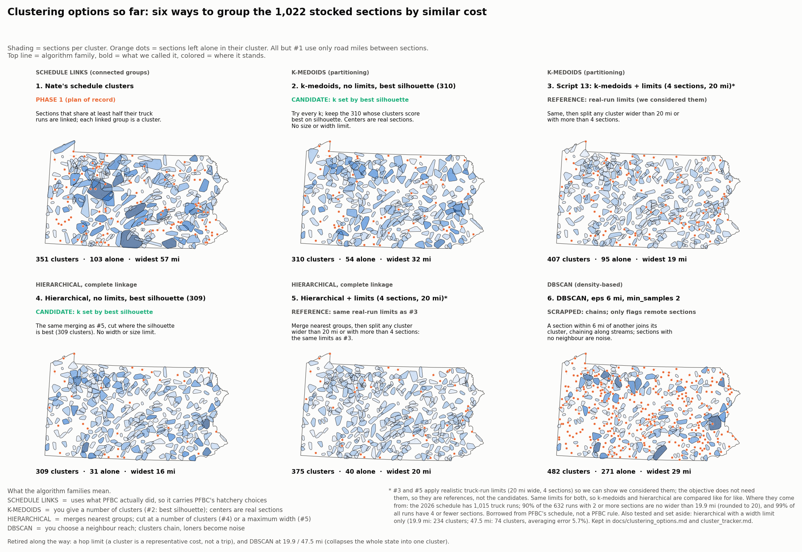

# Clustering options for the cost model (status 2026-10-01)

**Story so far (running tracker for the presentation): [`cluster_tracker.md`](cluster_tracker.md).**

## Objective (on record, Gavin, 2026-10-01)

A cluster is a group of sections that **cost about the same to reach from every hatchery**. It exists to hand the model one
representative cost per hatchery for the whole group. It is **not a trip**: nothing is routed or assigned to a cluster. The model
still decides `x[h, s]`, fish from hatchery h into section s, so different sections of one cluster can be supplied by different
hatcheries. A cluster only says "getting fish to this section costs about the same as getting them to that one", not that a
truck must visit every section.

- **Cost vector.** Each section s has `cost[h, s]` for every hatchery h (`2 × road miles × $ per truck-mile ÷ fish per load`).
  A cluster's representative cost from h is the mean of its members' `cost[h, s]`.
- **Hatchery-agnostic.** No hatchery is attached to a cluster, and PFBC's schedule is not used (except for #1, the reference).
- **Does not matter:** trip width, hop distance, sections per cluster, fish counts, truckloads. They describe a truck run, and no run is modelled.
- **Kept only as a reference:** options #3 and #5 apply realistic truck-run limits (20 mi wide, 4 sections) so we can show that we thought about
  them. They are not the candidates; the objective does not need them.
- **Does matter:** how close the cluster's average cost is to each member's own cost, across hatcheries. Judged by mean and
  90th-percentile error, whether the cheapest hatchery for a section is preserved, and the extra cost (regret) if the model used
  the cluster average to pick. The number of clusters follows from an error tolerance, not a trip rule.

**Consequence for the options below.** The candidates are the no-limits, best-silhouette versions (#2 k-medoids, #4 hierarchical). #3 and #5 add the width and size limits as a reference. All of them group by road distance between sections, which is only a proxy for similar cost vectors. (Clustering the cost vectors directly was considered and dropped.)

**How clusters are graded.** Averaging error is measured over the hatcheries that currently produce fish in the 2026 trout schedule: 9 of the 13 (Bellefonte, Benner Spring, Corry, Huntsdale, Oswayo, Pleasant Gap, Reynoldsdale, Tionesta, Tylersville; Linesville and Pleasant Mount have 0 stream fish). The list is read from `hatchery_schedule_supply.csv` (`stream_fish_2026 > 0`) by scripts 13 and 15, so it follows the schedule if it changes.

## Plan of record (Gavin, 2026-10-01)

- **Scope: cluster identification only.** This document is about which sections go together, a labelling keyed on `section_id`.
  What math is applied to a cluster afterwards (a representative cost, with or without a detour charge) is a separate, later
  step and is the same whichever clusters are used.
- **Clusters are interchangeable inputs.** Nate's clusters are expected to ultimately serve as a representative cost too, so
  the clusterings can be switched in and out with everything downstream held fixed. (The repo does not yet say that Nate's
  clusters become a representative cost; his written docs describe a detour charge, which is still an open question. Treat the
  representative-cost use as not yet captured in the repo.)
- **Phase 1 uses Nate's clusters.** Gavin's come in as a **sensitivity** once settled: swap the labelling, re-run, compare.

## How the identification differs from Nate's on record

Checked against `docs/model_design.md`, `docs/data_methods.md` and `PROMPTS.md` on `origin/main`. Only how the clusters are
*identified* is compared here, not what is done with them.

**Basis for grouping**
- Nate: **PFBC's schedule.** Run = date + hatchery + meeting place + time; two sections link when they share at least half
  the runs of the less-visited one (an assumption, `cluster_share_min` 0.5). Behavior-based.
- Gavin: **cost similarity**, with no schedule: sections whose cost from every hatchery is about the same.

**Count**
- Nate: whatever the rule gives (351 default, 528 strict).
- Gavin: set by an error tolerance on how far a cluster's average cost sits from its members' costs.

**Hatchery**
- Nate: the run includes the hatchery, so his clusters carry PFBC's hatchery choices (a few even mix hatcheries).
- Gavin: hatchery-agnostic, so the model stays free to choose per section.

**Distances**
- Nate: straight-line miles between section midpoints × a flat circuity factor of 1.3 (`data_methods.md`).
- Gavin: real OSRM road miles (measured circuity runs about 1.5 under 10 mi, 1.3 over 80 mi).

**Where they agree**
- Both leave real truck routing out of scope and are labelled assumptions, not tested against PFBC's actual costs.

**Each judged by the other's yardstick (from scripts 13 and 15)**
- Nate's clusters on Gavin's measure (cluster-average cost vs each member's own): **3.0%** error, against 1.7% to 2.8% for
  Gavin's options.
- Gavin's clusters on Nate's measure (real truck runs kept whole): **42% to 65%**, against 97% for his, which are built from
  those runs, so that comparison is circular.

**Where this lives.** This is Gavin's working document and is deliberately separate from `docs/model_design.md`, which still
carries Nate's cluster plan (run clusters, § Open questions: detour charge) unchanged. When this approach is settled, merge it
into `model_design.md` § Open questions as a third version next to Nate's two (geographic nearest-neighbour; schedule run
clusters), and update `CLAUDE.md` (Agreed simplifications) only after Nate agrees.

## Formal statement

- Each section s has a cost vector `c_s = (cost[h, s] for every hatchery h)`, with
  `cost[h, s] = 2 × road_mi[h, s] × cost_per_truck_mile / fish_per_load` (the existing `model_design.md` § Transport cost formula).
- A clustering assigns each section to a cluster k. The representative cost from h is `cbar[h, k]` = mean of `cost[h, s]` over
  the members of k, used in place of `cost[h, s]` for any s in k. The decision variables stay `x[h, s]`.
- Grade a clustering by (a) mean and 90th-percentile absolute error of `cbar[h, k]` against `cost[h, s]` over all hatchery and
  section pairs, (b) the share of sections whose cheapest hatchery is unchanged under `cbar`, (c) the regret: extra cost if the
  model picked the hatchery by `cbar`. Set the number of clusters from an error tolerance.
- Sections far apart on the map may share a cluster if their cost vectors match; geographic coherence is a readability
  preference, not a requirement.
- Status: options #2 to #6 below cluster by road distance between sections (a proxy for similar cost vectors); the width, hop and
  size limits some of them carry come from trip-style thinking that this objective supersedes. Clustering the cost vectors directly
  was considered and dropped (2026-10-01).

Regenerate: `python scripts/16_compare_methods_map.py` (needs scripts 12, 13, 15 run first).

## The two families that matter

| | |
|---|---|
| **Schedule links** (#1) | PFBC's own runs define the clusters. Faithful, but frozen to PFBC's hatchery choices. Reference only. |
| **Geography only** (#2–#6) | Road miles between sections decide. The model stays free to choose hatcheries. |

Inside geography-only there are three algorithm families:

- **K-medoids** (#2, #3): you give a number of clusters (#2 picks it by best silhouette); centers are real sections. Script 13.
- **Hierarchical, complete linkage** (#4, #5): merges the nearest groups step by step; you cut the tree at a number of clusters (#4 picks it by best silhouette) or at a maximum width (#5). Script 15.
- **DBSCAN** (#6): you choose a neighbour reach; clusters chain and loners become noise. Script 14 (scrapped, code kept).

## Where each option stands

1. **Nate's schedule clusters** (351). *Reference.* `section_schedule.cluster_id`.
2. **k-medoids, no limits, k set by the best silhouette** (310). *Candidate.* Try every k from 20 to 700 (two runs each), keep the one with the best mean silhouette (0.39). The peak is a plateau: every k from 240 to 330 scores within 0.01, so 310 is the top of a flat range, not a sharp optimum. `section_medoid_clusters.silhouette_best_cluster_id`.
3. **Script 13: k-medoids + limits** (407). *Reference: real-run limits.* Limits: 20 mi wide, 4 sections (hatchery-distance error 1.7%, the smallest of any option). `section_medoid_clusters`.
4. **Hierarchical, no limits, k set by the best silhouette** (309). *Candidate.* The same complete-linkage merging as #5, cut at the k with the best silhouette (0.44, the highest of any option; averaging error 2.2%; widest cluster 15.6 mi). Deterministic, so no random-start noise. The peak is a plateau: every k from 269 to 392 scores within 0.01. `section_hierarchical_clusters.silhouette_best_cluster_id`.
5. **Hierarchical + limits** (375). *Reference: real-run limits.* The same complete-linkage merging as #4, with the same limits as #3 (20 mi wide, 4 sections), so k-medoids and hierarchical are compared like for like: 375 clusters against 407, silhouette 0.38 vs 0.35, 40 sections alone vs 95, averaging error 1.9% vs 1.7%. `section_hierarchical_clusters.limits_cluster_id`.
   - **Set aside: hierarchical with a width limit only (19.9 mi, no section cap)**: 234 clusters, silhouette 0.42, 15 alone, averaging error 2.8%. Still saved as `width_only_19_9_cluster_id` and as a reference row in `comparison.csv`.
   - **Also set aside: width-limited 47.5 mi**, the widest real run: 74 clusters, silhouette 0.34, averaging error 5.7% (double the others). Too wide to give an accurate average cost. Still saved as `width_only_47_5_cluster_id` and as a reference row in `outputs/tables/hierarchical_clusters/comparison.csv`, but no longer drawn.
6. **DBSCAN, eps 6 mi** (482, 271 alone). *Scrapped.* Useful only for flagging remote sections.

## The decision that was left (before the objective above)

**#3 (k-medoids + limits) vs the width-only hierarchical version (set aside)**: accurate cost against faithfulness to real runs. #3 gives the smallest averaging error (1.7% vs 2.8%) but keeps only 42% of real truck runs whole (65% for the width-only version, which also needed fewer clusters, 234 vs 407). Superseded by #5, which gives hierarchical the same limits as #3.

## Where "4 sections, 20 mi" and the width numbers come from

All of these are measured on PFBC's 2026 schedule, using the same road-mile matrix the clusters use. The schedule has 1,015 truck
runs; 632 of them stock two or more sections.

- **20 mi (options 3 and 5):** 90% of the 632 multi-section runs are no wider than **19.9 mi** (width = the two
  farthest sections of a run). Rounded to 20 mi.
- **47.5 mi (set aside):** the widest real run (the Codorus State Park runs).
- **4 sections (options 3 and 5):** 99% of all 1,015 runs have 4 or fewer sections, and 4 is the 90th percentile among the multi-section
  runs (the 90th percentile over all runs is 3, because 38% of runs stock a single section). The most in any run is 7.
- **Not a PFBC rule.** They are what real runs happen to look like, borrowed to set a sensible scale. Under the
  representative-cost objective they only control how tight a cluster is. They are stored in `parameters.csv`
  (`cluster_max_width_mi`, `cluster_max_sections`, `run_width_max_mi`) with the same wording.
- Footnoted on the overview figure (`options_overview.png`, * and †).

## Ideas we tried and retired

- **Hop limit** (longest jump between two sections in a run). Dropped: a truck's fuel is spent whether on one leg or many;
  only total reach (width) matters. It also changed almost nothing (sections link into 3 groups at 17.7 mi).
- **Section-count cap**. Dropped for cost purposes: a cluster only supplies an average cost, so size doesn't enter the
  cost. Width keeps the average accurate. (Script 13 still uses a 4-section cap.)
- **DBSCAN at 19.9 / 47.5 mi**. `eps` is a neighbour reach, not a width, so clusters chain and the whole state becomes one
  cluster. At 6 mi it behaves, but is the weakest option for cost.
- **k-medoids then split for the width rule**. Worse than complete linkage at the same width (270 vs 234 clusters,
  silhouette 0.34 vs 0.42).
- **Fish counts / truckload in clusters**. Deliberately ignored; see `scenarios_and_extensions.md`.

## Where the numbers come from

The 20 mi and 4-section limits (options #3 and #5, reference only) and the two width-only versions (19.9 mi and 47.5 mi, set aside) come from
the real-run numbers above: the 90th percentile of run width is 19.9 mi, the widest run is 47.5 mi (`parameters.csv`, `run_width_max_mi`).
Real runs: 632 multi-section runs; the longest single hop is 46.5 mi (Codorus State Park).
